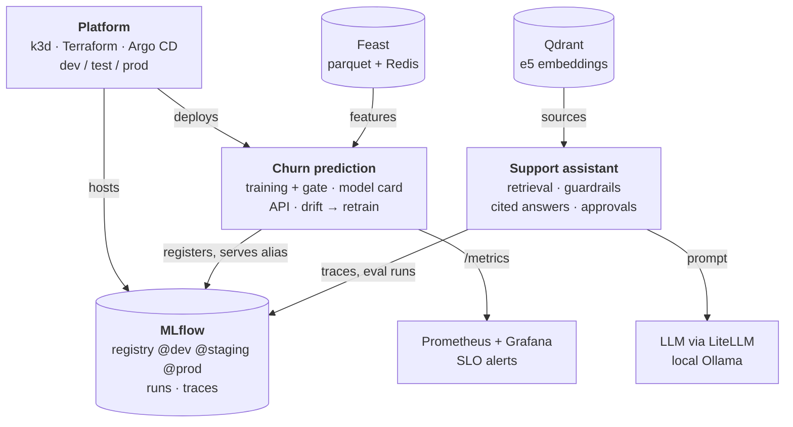
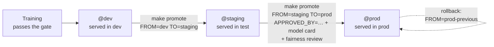

# Architecture

The repository is one uv workspace with two ML products and the platform that runs them. The products are what a product team would own; the platform and the service template are what a central ML platform team would provide.

Each component page has the detailed flow: [churn pipeline](churn/index.md#pipeline), [assistant retrieval](support-rag/index.md#retrieval-pipeline), [GitOps](platform/index.md).

## Shared building blocks

| Concern | Choice | Used by |
| --- | --- | --- |
| Experiment tracking, model registry, traces | MLflow 3 with **aliases** (`@dev`, `@staging`, `@prod`); stages are deprecated | churn, assistant (traces and evaluation runs), platform |
| Configuration | pydantic-settings with `CHURN_*` and `RAG_*` environment variables | both products ([Configuration](reference/configuration.md)) |
| Serving | FastAPI with a validated request contract | churn API, assistant API, generated services |
| Packaging | One uv workspace, one lock file, non-root container images | everything |
| Deployment | Helm charts deployed by Argo CD from `main` | platform |

## How a model reaches production

Code and models move on separate tracks, and each move leaves a record.

- **Models** are never copied between environments. All environments read one registry and each serves one alias, so the version in prod is the exact artifact that was tested. The approver and timestamp are tags on the version.
- **Images** move by pull request: `make promote-image ENV=test`, then `ENV=prod`, each editing one immutable `sha-` tag. CI refuses a prod image that hasn't run in test.
- **APIs follow their alias:** a promotion or rollback takes effect within 30 seconds, without a restart.

See [Promotion](platform/promotion.md) for both tracks in detail.

## Repository layout

| Path | What |
| --- | --- |
| `churn/` | Churn package: data, training, registry, model cards, API, Feast definitions, drift monitoring |
| `support-rag/` | Assistant package, plus its corpus, prompts, evaluation sets and injection classifier |
| `platform/` | k3d cluster, Terraform, Helm charts, Argo CD apps and per-environment values, promotion scripts |
| `templates/ml-service/` | Copier template for new model services |
| `monitoring/` | Prometheus rules and Grafana dashboards for the Docker stack |
| `docs/` | This site (Zensical) |
| `scripts/` | Docker Compose wrapper |
| `data/` | DVC pointers to the raw data; local outputs (gitignored) |
| `.github/workflows/` | One CI workflow per component, plus the docs site |
