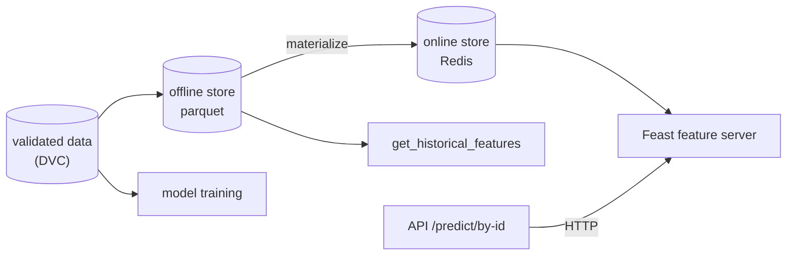

# Feature store

The call center knows a customer ID, not the 19 features the model needs. Feast serves those features, with the same values in training and serving.



- **Definitions** (`churn/feature_store.py`, registered by `churn/feature_repo/`): entity `customer`, feature view `customer_features` (19 features), and feature service `churn_model`, which the API requests by name.
- **`/predict/by-id`:** the call center sends only customer IDs. The API fetches the features from the Feast feature server over HTTP, which keeps the Feast SDK out of the serving image. The features are validated against the same `CustomerFeatures` contract as `/predict`, then scored. Unknown IDs return 404; a feature server that is down returns 503.
- **Offline/online parity:** tests check that the offline retrieval, the online retrieval and the source data are identical, and that the model gives bit-identical scores on both paths. Live check: `/predict/by-id` and `/predict` with the raw CSV record return exactly the same probability.

## Try it

```bash
make up features serve-docker
curl -X POST localhost:8000/predict/by-id -H 'Content-Type: application/json' -d '{"customer_ids": ["7590-VHVEG"]}'
```

`make features` publishes the features to both stores. If Redis loses its data, run it again.

!!! info "Version caps"
    Feast 0.66 caps `pandas` below 3 and `prometheus-client` below 0.25. Both are recorded as exceptions in [Versions](../versions.md).
