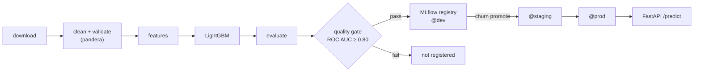

# Churn prediction

Predicts which customers are likely to cancel, both for the call center (real-time API) and for nightly retention campaigns (batch; planned).

Data: [IBM Telco Customer Churn](https://github.com/IBM/telco-customer-churn-on-icp4d), 7,043 customers, 26.5% churn.
The dataset is versioned with DVC (`data/raw/telco_churn.csv.dvc`). Every MLflow run is tagged with the same `data_md5`, so any registered model can be traced back to the exact data it was trained on.

## Pipeline



| Module | Role |
| --- | --- |
| `schema.py` | One definition of the customer record, shared by data validation and the API request model, so training and serving can't drift apart |
| `features.py` | Feature engineering as sklearn transformers, packaged inside the model artifact |
| `train.py` | Stratified split, MLflow tracking (params, metrics, dataset lineage). The model is registered only if ROC AUC ≥ `CHURN_MIN_ROC_AUC` (default 0.80) |
| `flows.py` | Prefect flow `churn-training` (fetch → train + gate → promote to `staging`) with retries on the data fetch. Automatic promotion to `prod` is refused on purpose, because prod needs a human approval |
| `tune.py` | Optuna search (TPE, seeded) scored by 5-fold CV on the training split only, so the test metrics stay unbiased. Every trial is a nested MLflow run: `churn pipeline --tune-trials 30` |
| `model_card.py` | Model card generated for every registered version (Markdown + JSON in MLflow, tags and description on the version). See [Governance](governance.md) |
| `registry.py` | Alias-based promotion with automatic `<env>-previous` for rollback |
| `serve/app.py` | FastAPI service that serves `models:/telco-churn@prod` and validates every request field |
| `feature_store.py`, `feature_repo/` | Feast definitions. See [Feature store](feature-store.md) |
| `drift.py`, `simulate.py` | Drift detection and a traffic simulator. See [Monitoring & drift](monitoring.md) |

## The API

| Endpoint | Purpose |
| --- | --- |
| `POST /predict` | Score up to 1,000 full customer records |
| `POST /predict/by-id` | Score customers by ID; features come from the Feast feature server |
| `GET /health` | Readiness: 503 `waiting_for_model` until a model is loaded |
| `GET /livez` | Liveness: answers as long as the process runs |
| `GET /metrics` | Prometheus metrics |

The API **follows its alias**: it checks the registry every `CHURN_MODEL_REFRESH_SECONDS` (30 s), so a promotion or rollback takes effect without a restart. If the registry is unreachable, a running API keeps serving the model it has.

## Baseline

| Metric | Default params | Tuned (25 Optuna trials) |
| --- | --- | --- |
| CV ROC AUC (train split) | 0.845 | 0.851 |
| Test ROC AUC | 0.844 | 0.847 |
| Test PR AUC | 0.655 | 0.665 |
| Test F1 @ 0.5 | 0.577 | 0.575 |

Tuning gives a small but real gain on the held-out test set. The data, not the hyperparameters, is the limiting factor.

## Usage

```bash
uv run churn download
uv run churn train                     # or: uv run churn pipeline (Prefect, promotes to staging)
uv run churn promote --from staging --to prod --approved-by "Your Name" [--fairness-reviewed]
uv run churn serve                     # http://127.0.0.1:8000/docs
```

Rollback: `uv run churn promote --from prod-previous --to prod --approved-by "Your Name"`.

All settings can be overridden with `CHURN_*` environment variables; see [Configuration](../reference/configuration.md#churn).
