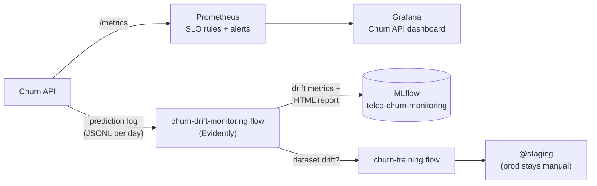

# Monitoring & drift



## SLOs and alerts

| SLI | SLO |
| --- | --- |
| Availability (scrape `up`) | 99.5% |
| p95 `/predict` latency | < 300 ms |
| 5xx ratio on `/predict` | < 1% |

The alert rules are in `monitoring/prometheus/rules/`, and each alert links to its section of [the runbook](../runbooks/churn-api.md).

## Drift

- **Drift rule:** a feature drifts when its distance from the training distribution is ≥ 0.1 (Wasserstein for numeric features, Jensen-Shannon for categorical). The dataset drifts when ≥ 25% of features drift, over ≥ 200 predictions from the last 7 days.
- **Fast signal:** the `ChurnPredictionShift` alert fires when the predicted churn rate stays far above the 26.5% base rate. Evidently then shows *which* features moved.
- **Retraining is automatic, promotion is not:** a drift-triggered model lands in `staging`. A person compares it with `prod` and promotes it.

## Demo

Full stack in Docker; Grafana at <http://localhost:3000>, Prometheus at <http://localhost:9090>.

```bash
make up train features               # MLflow + Redis, a trained model, online features
make promote APPROVED_BY="Your Name" FAIRNESS_REVIEWED=1
make serve-docker                    # API + feature server + Prometheus + Grafana
make demo-drift                      # normal traffic -> price-increase scenario -> drift check -> retrain to staging
```

Sample run: 6 of 19 features drifted (tenure, charges, contract, internet service, payment method), dataset drift 0.32 ≥ 0.25. Retraining registered a new version in `staging`, and `prod` was unchanged.
