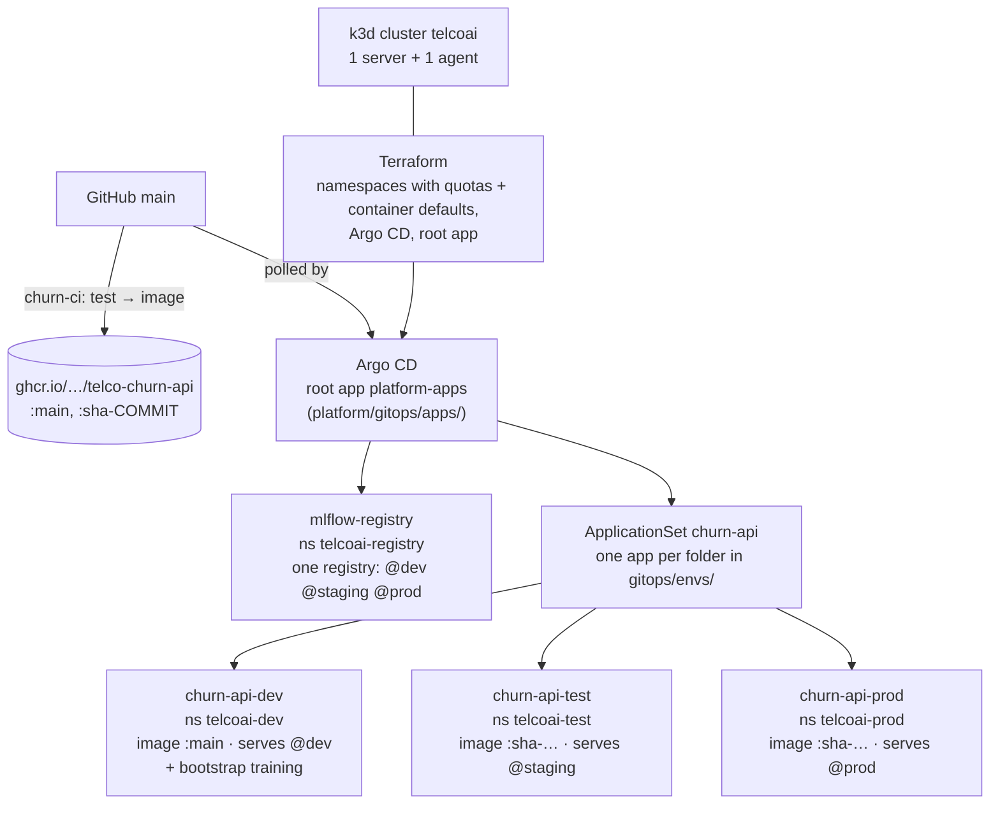

# Platform: Kubernetes, Terraform, GitOps

The hub layer: product teams ship a Helm chart and an image; the platform gives them environments with a budget and deploys whatever `main` says. Nobody runs `kubectl apply` by hand.



## Run it

Needs k3d, Terraform, Helm and kubectl (`scoop install k3d terraform helm kubectl`) and a Docker engine (Rancher Desktop works).

```bash
make cluster-up       # k3d cluster + platform/.kube/telcoai.yaml
make platform-apply   # namespaces, quotas, Argo CD, root app
make argocd-ui        # prints the admin password, then http://localhost:8081
```

Argo CD then deploys the registry and the three environments on its own. In dev, the bootstrap job trains a model (a few minutes on a fresh cluster, mostly image pulls), then the API turns ready. Test and prod run but stay unready (no traffic) until a person promotes a model; the API notices within 30 s:

```bash
make registry-ui &    # registry on http://localhost:5001
CHURN_MLFLOW_TRACKING_URI=http://localhost:5001 make promote FROM=dev TO=staging
CHURN_MLFLOW_TRACKING_URI=http://localhost:5001 make promote FROM=staging TO=prod APPROVED_BY="Your Name" FAIRNESS_REVIEWED=1

KUBECONFIG=platform/.kube/telcoai.yaml kubectl -n telcoai-test port-forward svc/churn-api 18001:8000
curl localhost:18001/health     # {"status":"ok","model_version":"1"}
```

`make cluster-down` deletes everything.

!!! info "Isolated kubeconfig"
    Every command uses `platform/.kube/telcoai.yaml`. The cluster definition never touches `~/.kube/config` or the current context, so other clusters on the same machine are safe.

## Layout

| Path | What |
| --- | --- |
| `k3d/cluster.yaml` | Cluster definition. It never touches `~/.kube/config` or the current context |
| `scripts/k3d.sh` | Runs k3d locally, or inside the Rancher Desktop VM when the Windows Docker pipe is unavailable |
| `scripts/promote-image.sh` | Opens the image promotion PR |
| `scripts/check-promotions.sh` | The promotion rules CI enforces, for every service |
| `scripts/validate-manifests.sh` | Lints every chart and validates its manifests for each environment, plus the Argo CD apps (CI) |
| `terraform/` | Namespaces (`ResourceQuota`, `LimitRange`), Argo CD, and the root application |
| `charts/mlflow-registry/` | The shared MLflow registry |
| `charts/churn-api/` | Churn API serving one alias, plus the optional dev bootstrap job |
| `gitops/apps/` | What Argo CD deploys: the registry `Application` and the churn-api `ApplicationSet` (app of apps) |
| `gitops/envs/<env>/` | Values per environment: the only files a deployment PR changes. A new folder is a new environment |

## Platform CI

`platform-ci` runs on every change under `platform/`:

- **charts:** helm lint and kubeconform schema checks for every chart, environment and Argo CD app; charts must refuse to render without an image tag;
- **promotions:** the rules in `check-promotions.sh` (immutable tags, image exists, prod only after test);
- **terraform:** `fmt` and `validate`.

Next: [Promotion](promotion.md) · [Design decisions](design.md) · [Service template](service-template.md)
