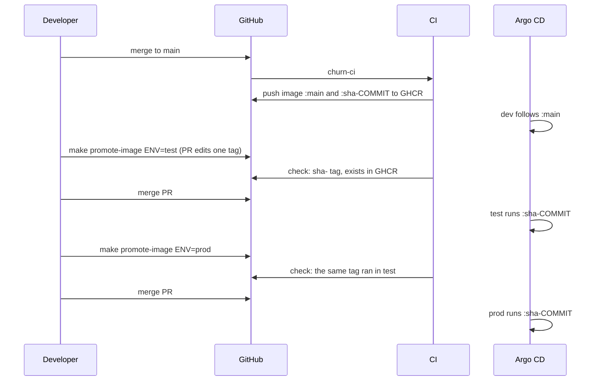

# Promotion

Code and models move separately, and each move leaves a record.

| What moves | How | Gate | Record | Rollback |
| --- | --- | --- | --- | --- |
| **Image** (API code) | `make promote-image ENV=test [SHA=…]`, then `ENV=prod`: opens a PR that edits one tag | CI: immutable `sha-` tag, exists in GHCR, prod only runs an image that has been in test | the merged PR | revert the PR |
| **Model** (registry) | `make registry-ui`, then `make promote FROM=dev TO=staging` / `FROM=staging TO=prod APPROVED_BY=…` | quality gate at training; prod needs a named approver, a model card, the fairness review | tags on the model version | `make promote FROM=prod-previous TO=prod APPROVED_BY=…` |

Dev needs neither: it runs the latest image from `main` and the newest model that passed the gate.

## Image track



Other services use the same scripts: `make promote-image SERVICE=<name> ENV=test`.

## Model track

The model track is the registry promotion from [Churn governance](../churn/governance.md), pointed at the cluster's shared registry:

```bash
make registry-ui &
CHURN_MLFLOW_TRACKING_URI=http://localhost:5001 make promote FROM=dev TO=staging
CHURN_MLFLOW_TRACKING_URI=http://localhost:5001 make promote FROM=staging TO=prod APPROVED_BY="Your Name" FAIRNESS_REVIEWED=1
```

Each environment's API follows its alias, so a model promotion or rollback reaches the running pods within 30 seconds, without a deployment. On the cluster, moving an alias from version 1 to 2 switched the running pod in about 10 s.
