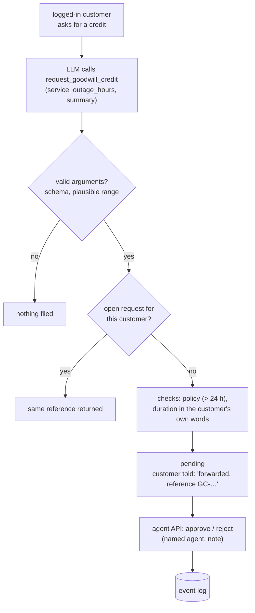

# Human approval for actions

The assistant can **propose** an action but never execute one. A person decides.

- **Offered only to identified customers.** The tool is offered only when the authenticated channel passes a `customer_id`. Anonymous users get normal help, and the model never sees the tool.
- **Code enforces the rules, not the model.** The state machine only allows `pending → approved | rejected`, and a decision needs a named agent. Every change is appended to an event log (`proposed` by the assistant, then `approved`/`rejected` by the agent, with a note). The action is linked to the request's trace through `request_id`.
- **Policy checks are advice, not verdicts.** Models extract numbers badly in ways that matter: qwen2.5 turned *"3 Tage"* (3 days) into `outage_hours: 3`, and also sent `{"type": "number", "value": 30}` instead of `30`. Arguments are normalized. The outage duration is cross-checked against the customer's own words by a deterministic parser for all four languages (`3 Tage`, `2 jours`, `36 ore`, `1,5 giorni`), and disagreements are flagged `extraction_mismatch` for the agent rather than silently rejecting a legitimate claim. Only schema violations are refused outright.
- **Provider errors don't break conversations.** Ollama once returned a 500 for a malformed tool call. Any model or provider failure now becomes the fallback answer, recorded as `generation_failed` with the error for the audit log.
- **Agent API** (`X-Agent-Token`, compared in constant time):
    - `GET /actions?status=pending`, with parameters, checks and the redacted question,
    - `POST /actions/{id}/approve` and `/reject` with `{agent, note}`: 409 if already decided, 404 if unknown.

## Action evaluation

`rag eval-actions` runs 16 cases through the full assistant, 4 per language:

- **8 genuine compensation requests,** with the expected outage duration.
- **8 look-alikes:** outage questions without a compensation request, device refunds, duplicate-payment refunds, discount requests.

| Model (`answer@v3`) | Proposes when it should (recall) | Never proposes wrongly (precision) | Duration extracted correctly |
| --- | --- | --- | --- |
| **Granite 4.2 8B** (default) | **7/8** | **100%** | **100%** |
| qwen2.5 7B | 2/8 | 100% | 100% |

- **The best model depends on the task.** qwen2.5 was slightly ahead on answer quality, but it rarely uses the tool: it keeps answering instead, and some of those answers were caught as ungrounded. Granite, which is trained for tool use, handles it well. That evidence supports keeping Granite 8B as the default.
- **The prompt mattered.** With the tool instruction at the *end* of the rules (after "reply NO_ANSWER if the sources don't cover it"), qwen2.5 proposed nothing at all (0/8), and Granite crashed on a malformed tool call. Moving it to the top, with an explicit precedence over NO_ANSWER, fixed that. Since `answer@v3` wasn't released yet, it was edited in place. It shows no regression on answer quality (gate passed at 96% quality).
- `make rag-eval-gen` also runs `rag eval-actions --gate` (recall ≥ 75%, precision ≥ 95%, duration accuracy ≥ 90%).

## Live check

Against the real model, through the API:

1. A German customer asking for a credit for 3 days without internet got a reference number.
2. Asking again returned the same reference.
3. The same question without login got normal help.
4. The agent API refused access without a token (401).
5. The agent saw the proposal: 72 h, eligible, no extraction mismatch.
6. The approval by "Anna Agent" was logged.
7. Rejecting the already-approved request was refused (409).
