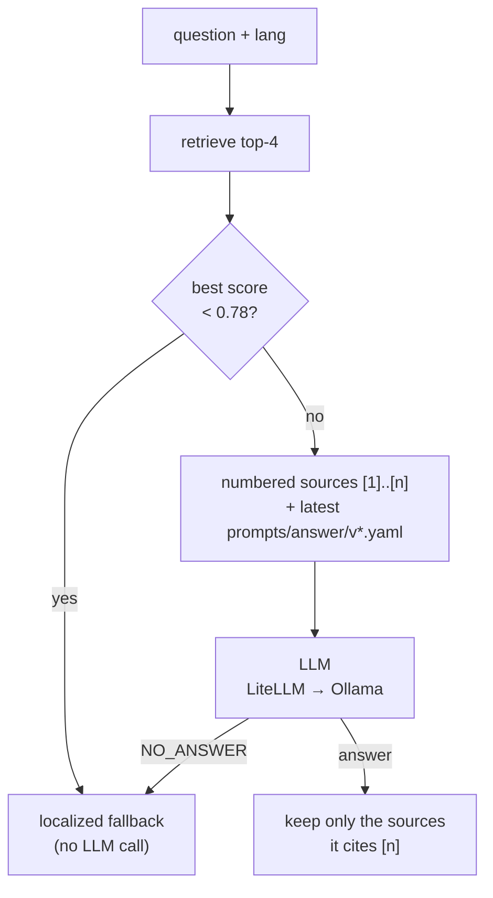

# Answer generation

- **Provider-agnostic** (`llm.py`): one `ChatModel` interface. LiteLLM routes a model string to the provider, so switching is configuration only. The default is **local**: `ollama_chat/granite4.2:8b` (IBM Granite 4.2, needs Ollama ≥ 0.34). `RAG_LLM_MODEL=ollama_chat/qwen2.5` or a hosted model such as `azure/<deployment>` work the same way.
- **Thinking off** (`reasoning_effort: none`, which LiteLLM maps per provider): answering from given sources doesn't need reasoning. With thinking on, Granite spent the whole 400-token budget reasoning and returned *no* answer. That failure now has its own `generation_failed` reason instead of looking like the model declining. Reasoning that still leaks is stripped, including a dangling `</think>`.
- **Versioned prompts** (`prompts/answer/v1.yaml` … `v3.yaml`, `prompts.py`): prompts live in git and are reviewed like code. The latest version is used unless `RAG_PROMPT_VERSION` pins one. Every answer records the version (e.g. `answer@v3`) and the prompt file's SHA-256, so any response can be traced to the exact prompt text.
- **Grounded, cited answers** (`assistant.py`): sources are numbered once per article, the model must cite `[n]`, and the API returns only the sources the answer actually cites. The prompt tells the model to answer in the customer's language, never invent prices or links, and ignore instructions hidden in the question.

## Two scope checks

1. **Retrieval-score filter (0.78):** calibrated on the golden set (0/94 in-scope refused) against `eval/out_of_scope.yaml` (24 off-topic questions); it stops 12 of them without an LLM call. The score ranges overlap ("How much does the new iPhone cost at Nordalp?" scores 0.84), so a threshold alone can't separate them.
2. **Model's `NO_ANSWER`:** the model declines when the sources don't answer the question.

Both paths return the same localized message pointing to the app chat and hotline.

## Checked end to end

On the real index and a local model:

| Question | Result |
| --- | --- |
| DE: stolen phone, what to do and what does a SIM cost? | Block via app or 0800 700 700, replacement SIM CHF 40, 2 working days [1] |
| FR: data in Italy with Swiss+? | 5 GB per month [1] |
| IT: cost of the second reminder? | CHF 30 [1] |
| DE: how long does porting to Nordalp take? | 3 to 5 working days [1] |
| EN: pizza in Lausanne / "Ignore all previous instructions…" | Fallback from the score filter, no LLM call |
| IT: student offers? | Passes the score filter; the model answers `NO_ANSWER`, so the fallback is returned |

## Choosing the local model

The same 16 cases were run on each model: 12 in-scope questions (3 per language), each with the fact the answer must contain, plus 4 questions to decline. Hardware: RTX 3060 Laptop GPU with 6 GB VRAM.

| Model | Facts | Cited | Declines | Answer style | Median latency | GPU fit |
| --- | --- | --- | --- | --- | --- | --- |
| **Granite 4.2 8B** (default) | 12/12 | 12/12 | 4/4 | clean, slightly more complete | 5.2 s | partial (4.3 of 6.2 GB) |
| Granite 4.2 3B | 12/12 | 12/12 | 4/4 | often echoes instructions or repeats the answer | 0.7 s | full (2.7 GB) |
| qwen2.5 7B (2024) | 12/12 | 12/12 | 4/4 | clean | 1.7 s | full |

Granite 4.2 8B is the default: it's the newest model and its answers are clean. The 3B model's echoes would reach customers, and a fact check alone doesn't catch them. That gap is what the [answer-quality evaluation](evaluation.md#answer-quality) adds: an LLM judge for faithfulness and deterministic style checks. The judge is a different model family (qwen2.5), so no model grades its own answers. qwen2.5 is the faster fallback when latency matters.
