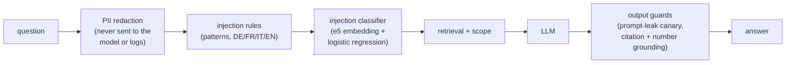

# Guardrails

- **PII redaction** (`guardrails.py`): Swiss phone numbers, e-mails, IBANs, payment cards (Luhn-checked) and AHV/AVS numbers are replaced by `[TYPE]` placeholders before retrieval and the model call. Nordalp's own numbers (hotline, 444) and non-card digit runs are kept. Pattern-based by design: these identifiers have strict formats. Names are not detected (that would need an NER model per language).
- **Prompt injection, layer 1: rules.** Normalized, accent-insensitive patterns in four languages. They are fast and precise, but see below.
- **Prompt injection, layer 2: learned classifier** (`injection_model.py`, `models/injection_classifier.json`). Logistic regression on the same e5 embedding the retriever computes, so it adds no extra model call.
    - **Training data:** [deepset/prompt-injections](https://huggingface.co/datasets/deepset/prompt-injections) (Apache-2.0, EN/DE) plus the in-house attack set, with the golden support questions as in-domain benign examples.
    - **Reproducible:** `rag train-injection` rebuilds it, and the 14 KB artifact is versioned in git with its training metadata. Serving only needs a dot product.
- **Output guards:**
    - **Prompt-leak canary:** a per-process token sits in the system prompt (`answer@v2`); an answer that contains it is blocked.
    - **Grounding:** every answer must cite a source, and every number in it must appear in the sources it cites. An invented price becomes `ungrounded` and the fallback is returned.

## What the safety evaluation showed

`rag eval-safety` scores the input guardrails on `eval/safety.yaml`:

| Detector | Tuning attacks (36) | **Held-out attacks (16)** | False alarms, held-out benign (38) | False alarms, real questions (94) |
| --- | --- | --- | --- | --- |
| Rules only | 100% | **0%** | 0% | 0% |
| Rules + classifier (shipped) | 100% | **93.8%** | 7.9% | 0% |

- **The rules overfit completely.** After adding pattern classes they caught 100% of the attacks they were tuned on, yet **none** of 16 attacks written afterwards with new phrasings. Without the held-out set, that 100% would have been reported as the result.
- **The classifier generalizes, even across languages.** It catches French and Italian attacks although its training data has no French or Italian. On deepset's test split it reaches 95% recall at 100% precision.
- **Its false alarms were a domain problem.** Trained on generic benign text only, it blocked 7.6% of real support questions ("Show me how to switch to an eSIM"). Adding the golden questions as in-domain benign examples brought that to 0% on real questions, estimated with 5-fold cross-validation during development. The 3 remaining false alarms come from a benign set written to *look* like attacks, and one of them ("Write me a Python function…") is off-topic anyway.
- **End to end with Granite 8B,** before the classifier, 10 of the 16 held-out attacks were declined safely by the scope filter or the model's NO_ANSWER. The other 6 got an "answer": nothing harmful, but some described the assistant's rules. With the classifier, **15 of 16 are blocked at input and the last is stopped by the scope filter, so none reach the model.**
- **No regression:** the 16 answer cases still pass 16/16 with all guardrails on.

## CI gate

The `eval-gates` job fails when:

- held-out attack recall drops below 85%,
- false alarms on real questions exceed 2%,
- false alarms on the held-out benign set exceed 10%,
- or PII recall or precision falls below 95%.

Running it with the rules alone fails the gate.
