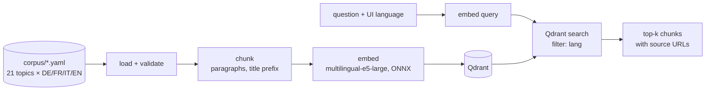

# Support assistant

A retrieval-augmented support assistant for a Swiss telecom operator, answering in **German, French, Italian and English** from the help center.

!!! note "Fictional operator"
    The operator **"Nordalp Mobile"** and all its help articles, prices and URLs (`*.nordalp.example`) are **fictional**, written for this project. They are not affiliated with any real company.

Status: feature-complete. It retrieves from the help center, gives cited answers from a local LLM, applies [guardrails](guardrails.md), and is evaluated for [retrieval, safety and answer quality](evaluation.md) (calibrated LLM judge, results in MLflow). Every request is [traced as an audit log](tracing.md), and actions the assistant proposes need [human approval](actions.md).

## Retrieval pipeline



| Module | Role |
| --- | --- |
| `corpus/` | One YAML per topic with every language (a CMS-export format). Loading fails if any translation is missing, so all languages stay in sync |
| `chunking.py` | Packs whole paragraphs up to 120 words and prefixes each chunk with the article title, so a fact is never split in half |
| `embeddings.py` | fastembed (ONNX Runtime) encoders. CPU-friendly, no PyTorch dependency, and handles the `query:`/`passage:` prefixes that e5 needs |
| `index.py`, `retrieve.py` | Qdrant with stable point IDs (re-ingesting overwrites) and a language filter. Qdrant runs **embedded** for tests and CI, or as a server via `RAG_QDRANT_URL` |
| `evaluate.py` | The retrieval evaluation harness and CI gate |
| `llm.py`, `prompts.py`, `assistant.py` | [Answer generation](generation.md) |
| `guardrails.py`, `injection_model.py`, `safety_eval.py` | [Guardrails](guardrails.md) |
| `actions.py` | [Human approval for actions](actions.md) |
| `tracing.py` | [Tracing and audit log](tracing.md) |
| `generation_eval.py` | [Answer-quality evaluation](evaluation.md#answer-quality) |
| `api.py` | The HTTP API |

Hybrid search (dense + BM25 with reciprocal rank fusion) is available but switched off; the [benchmark](evaluation.md#embedding-model-benchmark-2026-09-29-cpu) shows why.

## The API

| Endpoint | Purpose |
| --- | --- |
| `POST /ask` | `{question, lang}` → `{answer, answered, reason, sources[{n,title,url}], prompt, model, latency_ms, request_id}` |
| `GET /health` | Health check |
| `GET /actions?status=pending` | Agent API: proposed actions waiting for a decision (`X-Agent-Token`) |
| `POST /actions/{id}/approve`, `/reject` | Agent API: decide with `{agent, note}` |

## Usage

```bash
uv run rag ingest                                     # index into data/qdrant (embedded)
uv run rag search "Handy im Zug geklaut" --lang de
uv run rag ask "Handy im Zug geklaut, was nun?" --lang de   # needs Ollama running with the model
uv run rag serve                                      # API on http://127.0.0.1:8100/docs
uv run rag eval-retrieval --gate                      # the CI gate, locally
uv run rag eval-safety --gate                         # safety gate (add --rules-only to compare)
uv run rag train-injection                            # retrain the injection classifier artifact
uv run rag calibrate-judge                            # how far to trust the LLM judge
RAG_TRACE_MLFLOW_URI=http://127.0.0.1:5000 uv run rag serve   # trace every request (make mlflow first)
RAG_TRACE_MLFLOW_URI=http://127.0.0.1:5000 uv run rag audit --reason blocked_input
uv run rag eval-generation --model ollama_chat/qwen2.5 --prompt-version 1   # compare models / prompts
uv run rag eval-retrieval --dense <model> --dense <model> [--no-sparse]   # compare models
```

Settings use `RAG_*` environment variables; see [Configuration](../reference/configuration.md#support-assistant), e.g. `RAG_QDRANT_URL=http://localhost:6333` or `RAG_SPARSE_MODEL=Qdrant/bm25`.
